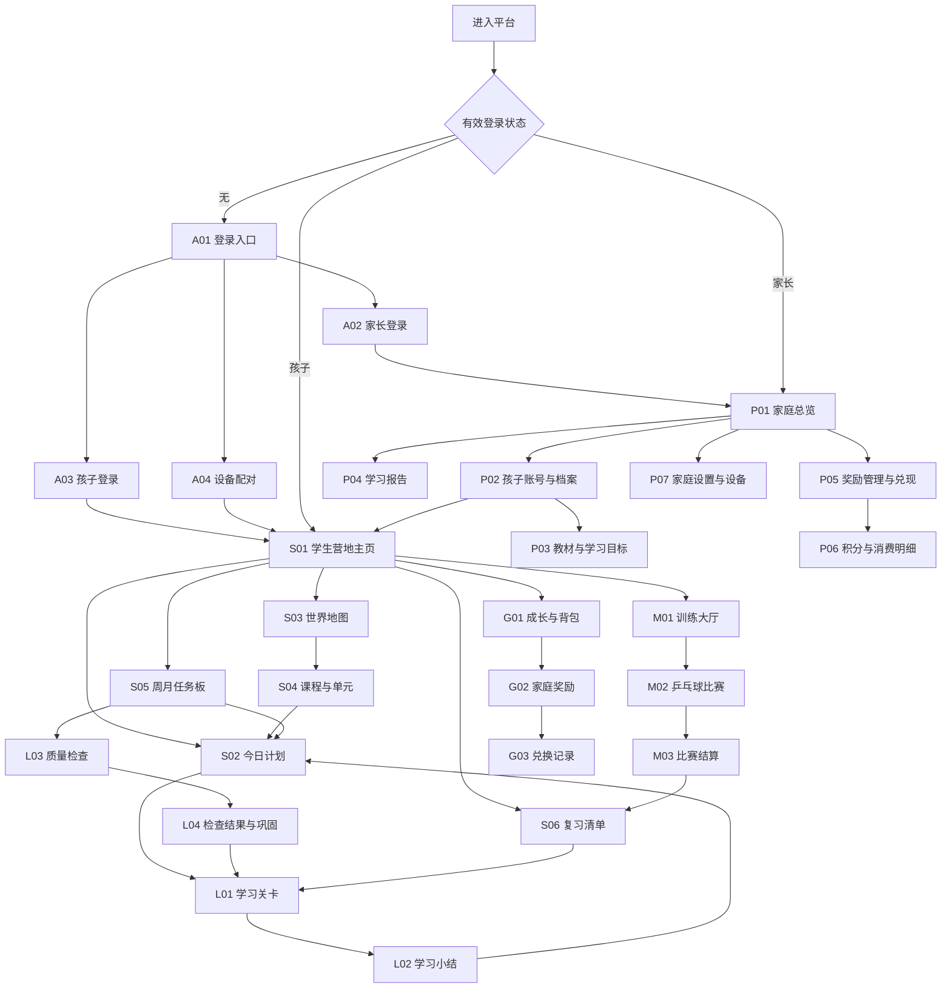

# Word 世界 · 全站页面与交互拉片

版本 1.0 · 2026-10-14 · 设计拆解稿，不代表功能已经实现。

## 1. 拆解目的与边界

以最新体素像素风大厅为起点，拆出整个平台的页面、操作、跳转和状态。这里的“拉片”是产品界面逐页拆解，不是对现有商业游戏的逐帧复刻。先确认信息架构和闭环，再逐页绘制桌面、平板、手机设计。

首版两条课程路线：弟弟零基础启蒙、姐姐人教精通六年级上册。初高中共用架构，未准备内容标注未上线。自建示例不得冒充真实教材单元。

页面编号用于设计和后续实现对照；路由为建议，无框架绑定。桌面侧栏与手机底部导航只是布局差异，不算两套页面。

## 2. 全站跳转地图

跨端基本规则：孩子只能访问自己的数据；家长可以选择孩子进入管理。共享设备的头像切换只能进入该设备已授权的孩子空间，不列出陌生账号。孩子设备进入家长区需要家长认证，PIN 不替代服务器权限校验。

## 3. 公共入口与账户（A）

| 编号／建议路由 | 页面功能 | 主要操作 → 去向 | 返回／异常规则 |
|---|---|---|---|
| A01 `/welcome` | 品牌入口、家长／孩子身份选择，恢复已有会话 | 家长 → A02；孩子 → A03；家长配对 → A04 | 已登录直接进入对应空间；不自动显示其他家庭孩子 |
| A02 `/login/parent` | 家长登录、首次创建家庭、找回入口 | 登录成功 → P01；首次创建 → P02 | 实际认证方式在云选型后确定；错误提示不泄露账号存在性 |
| A03 `/login/child` | 简单唯一登录名＋密码，记住个人设备 | 成功 → S01；忘记 → 提示由家长重置；配对 → A04 | 昵称可重名；失败保留登录名，不保留密码 |
| A04 `/pair` | 显示一次性配对码／配对状态，等待家长授权 | 家长在 P07 确认孩子 → S01 | 过期刷新；未确认不登录；拒绝可重新申请 |
| A05 `/profiles` | 共享设备已授权孩子选择 | 选孩子 → S01；家长空间 → A02 或家长身份验证 | 当前任务先保存；独立孩子设备通常不经过此页 |

## 4. 学生主页逐区拉片（S01）

桌面／平板横屏以“世界场景＋真实可操作 HUD”为主体。手机竖屏：身份状态 → 场景入口 → 主操作 → 任务与成长，重新排版，不把桌面整体缩小。静态美术背景不内嵌动态数字和可变文字。

| 区域 | 信息与功能 | 点击／触摸后 | 设计要求 |
|---|---|---|---|
| 品牌与角色身份 | 昵称、头像、年级、当前孩子 | 头像 → 账号与切换弹层 | 等级不是掌握评分；等级规则未定前只用演示值 |
| 积分状态 | 可消费积分、同步状态 | 积分 → G01 积分页签 | 待同步奖励不能显示为可消费余额 |
| 世界主场景 | 单词森林、听力海岸、语法区域、阅读城堡、球场 | 学习地区 → S04 对应能力；球场 → M01 | 单词不是平台全部内容；未上线明确标记 |
| 今日任务摘要 | 当前任务、预计时长、继续位置 | 查看 → S02；开始／继续 → 已保存 L01 或 M02 | 继续按钮明确是继续学习还是比赛；不能把二者混为一个存档 |
| 任务快捷入口 | 周／月数量进度与待验证项 | → S05 | 时间、学过数量、掌握数量分别显示 |
| 背包快捷入口 | 徽章、补签卡、装饰 | → G01 | 不让装扮妨碍开始学习 |
| 成长奖励栏 | 达成状态、可领取奖励 | 查看／领取 → G01 成就页签 | 首版自动发奖；点击仅打开详情或领取展示，不能重复获得 |
| 大号主按钮 | 开始下一段短学习／继续已暂停任务 | → S02 或带上下文的 L01 | 一屏只有一个最显著的行动；不随机跳转到题目 |
| 设置 | 音效、减少动画、字体大小、登录设备 | 设置弹层；账号操作需相应认证 | 麦克风按需申请，不在主页自动申请 |
| 家长入口 | 查看报告和管理 | 验证家长身份 → P01 | 不能点击就直接取得家长权限 |

场景图上的按钮保留文字与焦点，键盘和触屏等效。装饰点击、滑动地图、换装不算学习时长。

## 5. 学生任务、课程与复习（S）

| 编号／路由 | 功能分区 | 操作 → 去向 | 需要设计的状态 |
|---|---|---|---|
| S02 `/student/today` | 短计划、顺序、预估时间、推荐原因、已完成段 | 开始／继续 → L01；休息 → S01；检查 → L03 | 未开始、部分完成、全部完成、暂停、无任务 |
| S03 `/student/world` | 世界地图、课程区域、启蒙／教材标识 | 选地区 → S04；球场 → M01 | 未上线、可学、已学；不靠刷装饰解锁必需课程 |
| S04 `/student/course/:id` | 教材／启蒙主题、单元、词汇听说读写任务 | 选择任务 → S02 单元计划；学习点详情弹层 | 正确版次、未上线、学习中、待复习；不靠封面编单元 |
| S05 `/student/missions` | 周／月页签，新词、复习、听说读写数量及检查状态 | 做任务 → S02；验证 → L03；薄弱项 → S06 | 量完成但待验证、待巩固、已达标、延期；目标修改留痕 |
| S06 `/student/review` | 到期知识点、错题原因、能力分类、短复习组合 | 开始 → L01 复习模式；来源 → S04 | 空清单、到期、延迟验证未到时间；同轮复习不重复算量 |

## 6. 学习与辅导（L）

L01 是一个通用学习容器，不为每种题重复建一套页面。不同能力使用独立组件和素材，统一保存、反馈及暂停逻辑。

| 编号／路由 | 页面功能 | 操作 → 去向 | 结果与恢复 |
|---|---|---|---|
| L01 `/learn/:session` | 当前孩子、任务进度、材料、题目、答案、发音、提示、讲解 | 提交 → 本页反馈；下一步 → 本页下一题；完成 → L02 | 提交前不记分；保存已提交事件和当前位置；未提交答案是否保留需明确提示 |
| L02 `/learn/:session/result` | 本次内容、首次／提示后表现、有效时长、奖励来源、复习安排 | 下个任务 → S02；待巩固 → S06；结束 → S01 | 不把一次答对写成已掌握；未同步展示待确认奖励 |
| L03 `/check/:session` | 周／月质量检查、覆盖内容、分段进度 | 提交 → 下一题；完成 → L04；休息 → 保存 | 无提示首次表现用于检查；需帮助可退出考核进入辅导，不伪装无提示通过 |
| L04 `/check/:session/result` | 模块表现、覆盖与样本、延迟复习、口语写作待评估 | 巩固 → L01；查看计划 → S05 | 达标、待巩固、待验证、待家长评估分开 |

### L01 内部组件

| 能力 | 内容／交互 | 主要反馈 |
|---|---|---|
| 词汇 | 听音、图片、英文、音标、词义、拼写、语境 | 发音、词义解释、易混点；词 ID 去重 |
| 听力 | 音频、播放状态、选图／选择／填空 | 原句、字幕按需开启、听力线索；不能点播放就算完成 |
| 口语 | 示范、按需录音、回放、自评／家长评估 | 录音失败提示；未接评分服务不显示 AI 分数 |
| 阅读 | 材料与题目、滚动／翻页、文本线索 | 回到对应段落、解释依据；滚动不能刷时长 |
| 句型／语法 | 简短讲解、组句／填空／应用 | 分步提示、例句，保留首次结果 |
| 写作 | 题目、输入区域、草稿、自查项 | 保存草稿；未评分标待评估，输入法不误判挂机 |
| 答疑 | 当前知识点提示、讲解、相似题 | 首版审核讲解；后续模型输出需要标识与校验 |

## 7. 乒乓球比赛（M）

| 编号／路由 | 页面功能 | 操作 → 去向 | 关键规则 |
|---|---|---|---|
| M01 `/student/training` | 日常赛／月赛／季度赛、内容范围、赛制、存档 | 新赛 → 赛前确认弹窗 → M02；续赛 → M02 | 日常三局两胜；月／季五局三胜；题库未准备不可开始 |
| M02 `/match/:id` | 局分、当前比分、题目、正式提交、回合反馈 | 下一回合 → 本页；局末 → 局间弹层；比赛结束 → M03 | 至少 11 分且领先 2 分；只有首次正式提交计分；保存并休息 |
| M03 `/match/:id/result` | 各局比分、首次作答表现、薄弱项、奖励与存档状态 | 复习 → S06；再训练 → M01；返回 → S01 | 不用胜利替代周／月综合检查，奖励去重 |

局间弹层提供下一局／休息。10:10、11:10、12:10 等分差状态分别设计；月赛不要求单次打完。多设备接续冲突必须先刷新，不能叠加比分。

## 8. 成长、背包与家庭奖励（G）

| 编号／路由 | 分区与功能 | 操作 → 去向 | 规则 |
|---|---|---|---|
| G01 `/student/growth` | 成就、签到月历、补签卡、积分明细、装扮／营地页签 | 补签 → 日期确认弹窗；徽章 → 详情；家庭奖励 → G02 | 补签不增加学习量；徽章长期保留；装饰材料与家庭积分分开 |
| G02 `/student/rewards` | 家长设置的奖励、价格、徽章条件、余额 | 申请 → 确认弹窗 → G03；奖励详情弹窗 | 申请不扣分；不能自行确认兑现；资格不足说明原因 |
| G03 `/student/redemptions` | 待处理／已兑现／拒绝／撤销记录，备注与退款 | 点记录 → 明细弹窗；取消待处理申请 | 只查看自己的记录；不可修改消费流水 |

装扮和建造首版可以只完成基础选择与展示，完整自由建造属于后续功能。物品栏是快捷导航，不意味着必须实现九种独立经济系统。补签卡、徽章、积分和装饰材料都有明确名称，不以同一种金币混用。

## 9. 家长管理（P）

| 编号／路由 | 页面功能 | 操作 → 去向 | 权限与异常 |
|---|---|---|---|
| P01 `/parent` | 两个孩子概览、周月学习量、质量、待评估／待兑现提醒 | 孩子 → P04；添加 → P02；奖励 → P05 | 不做兄弟姐妹排名；数据不足不显示虚构趋势 |
| P02 `/parent/children` | 创建／编辑子账号、昵称、唯一登录名、密码重置、头像 | 新建／编辑 → P03；授权设备 → P07；进入孩子 → S01 | 重名建议后缀；内部 ID 不可改，密码不明文回显 |
| P03 `/parent/children/:id/plan` | 地区、教材版次、当前单元、摸底、单次时长、周月数量、验证要求 | 预览 → 计划预览弹窗；保存 → P04 | 修改留痕；历史教材记录不覆盖；不要只提供分钟目标 |
| P04 `/parent/children/:id/report` | 周／月报告，词汇已学／掌握、模块表现、首次及补测、有效时长、记录 | 目标 → P03；知识点 → 明细；待评估 → 评价弹窗 | 口语写作未可靠评分时明确待评估；区分实际打卡与补签 |
| P05 `/parent/rewards` | 奖励目录、孩子范围、积分价、可选徽章条件、兑换申请、直接登记 | 编辑奖励弹窗；兑现确认 → P06；拒绝／取消 | 选中孩子、金额、余额、备注再确认；只有家长可扣分 |
| P06 `/parent/ledger` | 分孩子积分增减、消费备注、状态、原始记录与撤销流水 | 详情 → 明细弹窗；撤销 → 原因确认弹窗 | 消费、撤销去重；余额不负；退款留痕不可删除原记录 |
| P07 `/parent/settings` | 家庭账号、设备授权／撤销、配对、显示偏好、数据导出与删除 | 配对 → 选孩子确认；删除 → 高风险确认 | 撤销不影响其他设备；数据删除影响单独说明，不用普通装饰弹窗 |

## 10. 弹窗、抽屉和状态，不额外建页面

| 编号 | 交互单元 | 触发位置 | 必需操作 |
|---|---|---|---|
| D01 | 身份与孩子切换 | S01／A05 | 保存当前进度、选择已授权身份、家长验证 |
| D02 | 赛前说明／局间休息 | M01／M02 | 确认内容赛制、继续或保存休息 |
| D03 | 学习暂停／无响应提示 | L01／L03／M02 | 继续有限窗口、提示、休息；不追补无效时长 |
| D04 | 提示／讲解 | L01 | 提示层级、返回题目；使用提示留痕 |
| D05 | 补签确认 | G01 | 日期、卡数、连续链变化、确认／取消 |
| D06 | 徽章／道具／奖励详情 | G01／G02 | 来源、条件、已获得状态，不重复发奖 |
| D07 | 申请奖励确认 | G02 | 奖励、价格、资格，说明申请不扣分 |
| D08 | 家长兑现／直接登记 | P05 | 孩子、扣分、余额、备注、确认 |
| D09 | 撤销消费 | P06 | 原扣分、退款金额、必填原因、一次性确认 |
| D10 | 目标预览／修改记录 | P03 | 任务量、时长估计、质量条件、变更原因 |
| D11 | 装扮／建造选择 | G01 | 预览、独立材料、保存；未实现功能明确标注 |

所有业务弹窗包括提交中、成功、失败、可重试状态，不能点击按钮就预先宣布服务器操作成功。

## 11. 全局状态与返回规则

- 加载失败、离线、待同步、登录失效、空数据、内容未上线、权限不足都需画出。
- 当前孩子在学习页、比赛页与家长消费确认页始终明确，防止串档。
- 浏览器返回、关闭、横竖屏切换不隐式结束学习；已提交事件去重，未同步队列保留。
- 登录失效先保存本地学习事件，再要求登录，不允许离线消费或补签确认。
- 无响应依据当前题型与实际内容进度，不依据鼠标或触摸次数；软键盘、音频和阅读有专门规则。
- 退出任务回到原入口：今日计划进入则回 S02，课程进入则回 S04，复习进入则回 S06。
- 设计中的进度数、积分、题目和质量结果是真实数据槽位，不固定写进背景图片。

## 12. 逐页视觉交付顺序

1. **第一组：主页与入口**：S01 横屏／手机竖屏，A01、A03、S02、S05。确认导航、视觉层级、主按钮和任务量。
2. **第二组：学习闭环**：L01 词汇／听力／阅读三种代表布局、提示及暂停状态、L02、L03／L04。
3. **第三组：比赛闭环**：M01、M02 正常比分／加分／局间／续赛、M03。
4. **第四组：成长兑现**：G01、G02／G03、补签与兑奖弹窗，P05／P06。
5. **第五组：家庭配置**：P01–P04、P07、配对及共享设备切换；报告优先易读，减少装饰。

每组先做静态整页设计，再交付可点击流程，不把一张带文字的生成效果图直接当应用。第一组是下一步明确交付范围，不一次铺开所有页面。

## 13. 三条必跑的评审路线

- 弟弟：A03／A04 → S01 → S02 → L01 听音认图 → L02 → G01 查看奖励 → S01。
- 姐姐：S01 → S05 查看新词目标 → S02 → L01 → L02 → M01 → M02 续赛 → M03 → S06。
- 家长：A02 → P01 → P02 创建孩子 → P03 教材与任务量 → P04 报告 → P05 兑现 → P06 备注及撤销。

评审检查：任何奖励都能追溯来源，任何任务都能返回，未上线入口不会跳进伪造课程，两名孩子的数据与权限独立。
